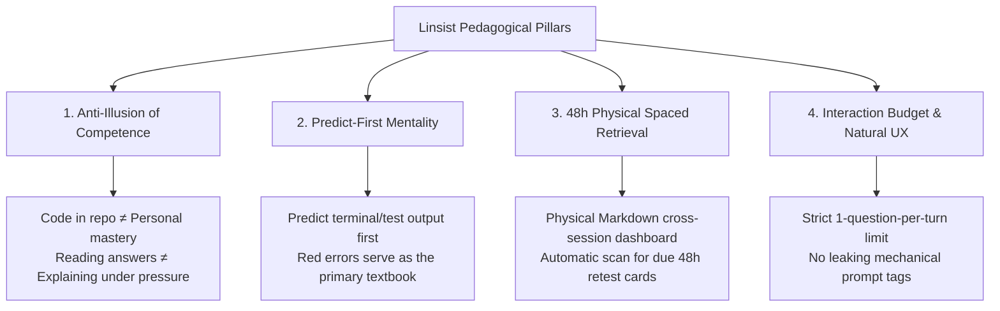

# Linsist: Open Agent Skills for Technical Mastery & Adaptive Mock Interviews

<p align="center">
  <a href="https://github.com/Lin-sist/Linsist-Skill/actions/workflows/ci.yml"></a>
  <a href="LICENSE"></a>
  <a href="README.zh-CN.md"></a>
  
  
</p>

---

## 📖 Overview

**Linsist** is a Agent Skills suite designed for computer science fundamentals, Linux system internals, and hands-on Java Agent & Enterprise RAG engineering.

Benchmarked against leading open-standard agent skills (such as `teach` and `build-to-learn`), Linsist bridges the gap between passive code reading and true engineering mastery through **predict-first exercises, active Feynman explanations, and physical 48h spaced retrieval**.

---

## 💡 Core Pedagogical Philosophy



1. **Anti-Illusion of Competence**:
   - Skimming AI-generated code or browsing complex repositories often creates a false sense of understanding.
   - True mastery is measured solely by whether you can articulate design trade-offs without notes, locate the exact source classes, and explain critical failure modes.
2. **Predict-First Mentality**:
   - Before executing a terminal command or running unit tests, learners must predict the expected output.
   - When a test fails, the agent never rushes to spoon-feed fixes; it guides learners through a structured debugging ladder: `Symptom → Error Log → Root Cause → Hypothesis → Verification → Fix`.
3. **48h Physical Spaced Retrieval**:
   - LLMs are stateless by default. Linsist establishes a physical `.linsist/` Markdown workspace to track mistake notes and 48-hour retest obligations across sessions.
4. **Interaction Budget & Natural UX ("后台词不出口")**:
   - Single-turn diagnosis is strictly limited to **1 focused question** to avoid conversational cognitive fatigue.
   - Mechanical prompt labels (e.g. internal tags like `[Verification: Passed]`) are strictly banned from conversational dialogue and saved silently into markdown records.

---

## 🏛️ Decoupled Architecture (Engine + Curriculum Packs)

Linsist is structured into two clean layers: **Generic Core Engine** and **Pluggable Curriculum Packs**:

```text
Linsist-Skill/
├── skills/
│   ├── linsist-coach/
│   │   ├── SKILL.md
│   │   ├── scripts/                 # Bundled initializer and scanner
│   │   └── references/
│   │       └── curriculums/         # Bundled Java Agent/RAG and custom packs
│   ├── linsist-interviewer/
│   ├── linsist-agent/                # Resume-targeted offline Agent coding drills
│   ├── linsist-basics/
│   ├── linsist-os/
│   └── linsist-testlab/
├── scripts/
│   ├── install.py                  # Installs and checks the complete suite
│   ├── init_workspace.py           # Source-checkout compatibility entry
│   └── scan_retest.py              # Source-checkout compatibility entry
└── tests/                          # Unit and installed-workspace regression tests
```

---

## 🛠️ Skills and Invocation

| Skill | Purpose | Example request |
| :--- | :--- | :--- |
| `$linsist-coach` | Daily study and spaced retrieval | Use Linsist to start today's study |
| `$linsist-interviewer` | Adaptive mock interview | Use Linsist to interview me based on this resume |
| `$linsist-agent` | Resume-targeted Agent foundations and offline coding | Practice one Agent mechanism from my resume |
| `$linsist-basics` | Java, collections and coding drills | Start today's Java basics practice |
| `$linsist-os` | OS mechanisms and Linux experiments | Help me learn process scheduling with a Linux experiment |
| `$linsist-testlab` | JUnit, Mockito and test analysis | Start a JUnit boundary-test exercise |

Automatic selection is enabled. Explicit `$skill-name` invocation is the most reliable way to select Linsist when similar teaching skills are installed. In Codex, use `/skills` or type `$` to find installed skills. The suite does not register aliases such as `/linsist` or `/study-coach`.

## 🚀 Install and Start

Python 3.9+ is needed for the helper scripts; the default runtime has no required third-party packages. PyYAML is needed for the repository test suite and is optional for reading more complex YAML configuration. Java/Maven/Gradle and Linux commands are only needed for exercises that use them.

### 1. Install the complete suite

```bash
git clone https://github.com/Lin-sist/Linsist-Skill.git
cd Linsist-Skill
python3 scripts/install.py
python3 scripts/install.py --check
```

The default destination is `~/.agents/skills`. Six `linsist-*` folders are installed directly under that root, including the coach's scripts and curriculum resources. If the source checkout is itself inside the destination skills root, the installer uses directory symlinks so Codex deduplicates the same canonical files. Otherwise it installs independent copies. On systems without symlink privileges, keep the source checkout outside the skills root. Linked installations follow local source changes.

On Windows PowerShell, use `py -3 scripts/install.py` and `py -3 scripts/install.py --check`. For a different client or project, set its supported skills root explicitly:

```bash
# Claude Code
python3 scripts/install.py --dest ~/.claude/skills
# Project-local Codex skills; replace the path with your actual project
python3 scripts/install.py --dest /path/to/project/.agents/skills
```

Cursor, Windsurf, and OpenCodeInterpreter require the skills location and invocation syntax supported by that client/version; these clients have not been tested here. Existing folders are preserved unless `--update` is explicitly passed. To update this suite, use `python3 scripts/install.py --update`; keep personal notes in the learning workspace, outside installed skill folders.

### 2. Start from your learning project or notes workspace

On your next turn, select `$linsist-coach` and say:

```text
$linsist-coach Start today's study. My learning workspace is /path/to/my-project.
```

The coach initializes missing workspace files, checks due retests, and starts with one question. A completed learner profile is optional. You can also invoke any specialized skill directly. The interviewer starts from your resume and optional JD without reading local learning records.

If the skills do not appear, restart the client and check again. The repository tests verify installed resources and CLI behavior; automatic model selection and dialogue quality still depend on the host and are not guaranteed by static checks.

### 3. Optional manual workspace and retest commands

From any directory, use the installed script's absolute path and pass the learning workspace with `--dir`:

```bash
python3 ~/.agents/skills/linsist-coach/scripts/init_workspace.py --dir /path/to/my-project
python3 ~/.agents/skills/linsist-coach/scripts/scan_retest.py --dir /path/to/my-project --json
# Read-only scan
python3 ~/.agents/skills/linsist-coach/scripts/scan_retest.py --dir /path/to/my-project --json --no-dashboard
```

Inside the source checkout, the original `python3 scripts/init_workspace.py --dir ...` and `python3 scripts/scan_retest.py --dir ...` entry points remain available.

Workspace state is stored in `.linsist/config.md`, `learner-profile.md`, `notes/`, `mistakes/`, and `retest_dashboard.md`. Original note cards are the source of retest status; edit them before rescanning. JSON and ordinary output both update the complete dashboard by default. `--stage 1` or `--stage 2` filters output only. Retests use local calendar dates, not exact hourly alarms, and run when requested or when a teaching skill starts; installation creates no background scheduler.

### 4. Verify a source change

```bash
python3 -m pip install -r requirements-dev.txt
python3 -m unittest discover tests -v
```

The integration test installs into a temporary skills root with spaces in the path, checks all local links, initializes an unrelated project, and exercises pending → first-stage passed → fully mastered status transitions. It also checks repeat initialization, read-only scans, and preservation of existing installations.

---

## Agent Foundations: Resume-Targeted Coding on Linux

`$linsist-agent` follows the basics coach style: one concept check, a short explanation, one 10–20 minute handwritten function, actual execution, then one interview follow-up. It prioritizes Agent mechanisms in the current resume and permits one small adjacent extension, rather than turning a long-term roadmap into a mandatory syllabus.

- **P0**: bounded Loop, Tool Calling, ReAct action/observation linkage, state transitions, context, time-banded memory, proposal confirmation, n-gram guardrails, one-shot reflection, and shared deadline budgets.
- **P1**: the minimum RPC/MCP concepts, trace metadata, and offline evaluation needed for interview gaps. Framework migration, multi-agent systems, GraphRAG and fine-tuning are optional future topics.
- Python standard library and a deterministic Fake LLM work offline with no API key. The scaffold intentionally leaves core functions empty. A fixture smoke pass is distinct from a student exercise pass; each exercise has its own acceptance contract.

```text
$linsist-agent Use my current resume to start one Agent foundations coding exercise. Do not provide the implementation before I submit code.
```

`/linsist-agent` and `/agent-practice` are recognized text trigger phrases, not automatically registered host slash commands; use `$linsist-agent` if the client intercepts unknown slash commands. The new skill can start independently; shared persistence uses the complete suite's existing `.linsist/` scanner. Personal resumes are not bundled or published.

See the [syllabus](skills/linsist-agent/references/curriculums/agent-foundations/syllabus.md), [exercise contracts](skills/linsist-agent/references/curriculums/agent-foundations/exercises.md), and [project alignment notes](skills/linsist-coach/references/curriculums/java-agent-rag/alignment-notes.md). General knowledge, synthetic experiments and verified Flashback/RAG capabilities remain separate; passing an exercise never creates resume project experience.

---

## 📚 Official Curriculum: Java Controlled Agent & Enterprise RAG

Linsist ships with an official flagship curriculum located in [`skills/linsist-coach/references/curriculums/java-agent-rag/`](skills/linsist-coach/references/curriculums/java-agent-rag/):

1. **Flashback Controlled Agent Runtime (S01 ~ S10)**:
   - Deterministic Finite State Machine (`AgentStageMachine`) preventing uncontrolled loops
   - Native Function Calling with strong DTO binding and tool whitelist validation
   - Human-in-the-Loop (HITL) 2-phase confirmation for destructive operations
   - Shared Deadline Budget and zero silent automatic retries
   - MySQL metadata memory with time labels and banded character budgets
2. **Enterprise RAG Retrieval Engineering (S11 ~ S20)**:
   - Hybrid Retrieval: Dense Semantic (Milvus IVF_FLAT; HNSW as an optional comparison) + Sparse Keyword (BM25)
   - Reciprocal Rank Fusion (`RRF`) score reconciliation
   - Heuristic reranking by default, with optional model reranking and explicit fallback
   - Citation snippet overlap checks, distinct from semantic entailment verification
   - Reliable Index Task Ledger with distributed `Lease Guard` heartbeats

*To plug in your custom project, refer to [`skills/linsist-coach/references/curriculums/custom-template/my-project.template.md`](skills/linsist-coach/references/curriculums/custom-template/my-project.template.md).*

---

## 🤝 Contributing

Contributions are warmly welcomed!
- Add domain-specific curriculum packs (e.g. Distributed Consensus, LLM Fine-Tuning).
- Create integrations for note-taking tools (Obsidian, Logseq, Notion).
- Improve prompt diagnostics and interaction budgets.

---

## 📄 License

This project is licensed under the [MIT License](LICENSE).
