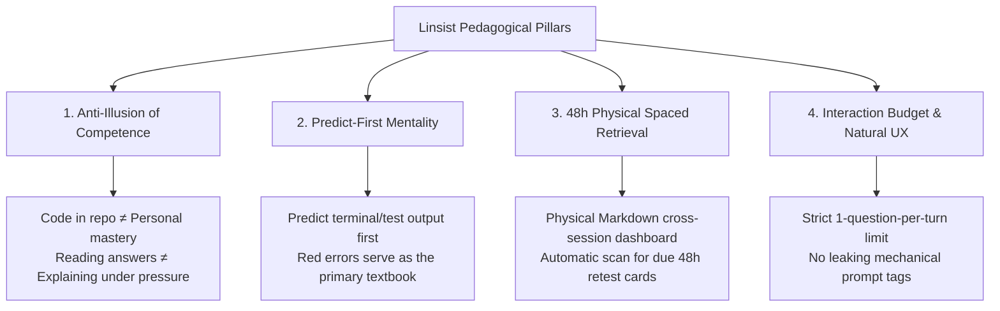

# Linsist: Open Agent Skills for Technical Mastery & Adaptive Mock Interviews

<p align="center">
  <a href="LICENSE"></a>
  <a href="README.zh-CN.md"></a>
  
  
</p>

---

## 📖 Overview

**Linsist** is a production-grade Agent Skills suite designed for computer science fundamentals, Linux system internals, and hands-on Java Agent & Enterprise RAG engineering.

Benchmarked against leading open-standard agent skills (such as `teach` and `build-to-learn`), Linsist bridges the gap between passive code reading and true engineering mastery through **predict-first exercises, active Feynman explanations, and physical 48h spaced retrieval**.

---

## 💡 Core Pedagogical Philosophy



1. **Anti-Illusion of Competence**:
   - Skimming AI-generated code or browsing complex repositories often creates a false sense of understanding.
   - True mastery is measured solely by whether you can articulate design trade-offs without notes, locate the exact source classes, and explain critical failure modes.
2. **Predict-First Mentality**:
   - Before executing a terminal command or running unit tests, learners must predict the expected output.
   - When a test fails, the agent never rushes to spoon-feed fixes; it guides learners through a structured debugging ladder: `Symptom → Error Log → Root Cause → Hypothesis → Verification → Fix`.
3. **48h Physical Spaced Retrieval**:
   - LLMs are stateless by default. Linsist establishes a physical `.linsist/` Markdown workspace to track mistake notes and 48-hour retest obligations across sessions.
4. **Interaction Budget & Natural UX ("后台词不出口")**:
   - Single-turn diagnosis is strictly limited to **1 focused question** to avoid conversational cognitive fatigue.
   - Mechanical prompt labels (e.g. internal tags like `[Verification: Passed]`) are strictly banned from conversational dialogue and saved silently into markdown records.

---

## 🏛️ Decoupled Architecture (Engine + Curriculum Packs)

Linsist is structured into two clean layers: **Generic Core Engine** and **Pluggable Curriculum Packs**:

```text
linsist/                                 # Repository Root
├── README.md                            # English Documentation
├── README.zh-CN.md                      # Chinese Comprehensive Guide
├── LICENSE                              # MIT License
├── .gitignore                           # Ignores local notes and caches
├── linsist.config.example.md            # Workspace persistence config template
│
├── skills/                              # 【Core Coaching Engines】
│   ├── linsist-coach/                   # Daily orchestrator & learning companion
│   ├── linsist-interviewer/             # Adaptive mock interviewer & debriefing
│   ├── linsist-basics/                  # Hands-on coding drills (Java, data structures, algorithms)
│   ├── linsist-os/                      # OS internals & Linux lab experiments (Ubuntu commands)
│   └── linsist-testlab/                 # Test-driven engineering (JUnit 5, Mockito, AAA, Quality Gate)
│
├── curriculums/                         # 【Domain Curriculum Packs】
│   ├── java-agent-rag/                  # Official Pack: Java Controlled Agent & Enterprise RAG
│   │   ├── projects-context.md          # Production architecture blueprints (Flashback & RAG)
│   │   └── syllabus.md                  # 20 high-frequency, hardcore knowledge slices
│   └── custom-template/                 # Community project template
│       └── my-project.template.md
│
└── scripts/                             # 【Automation Scripts】
    ├── init_workspace.py                # Initializes local .linsist/ directory
    └── scan_retest.py                   # Automated scanner for due 48h retests
```

---

## 🛠️ Skills Matrix & Triggers

| Skill Namespace | Role & Domain | Primary Responsibilities | Slash Commands / Triggers |
| :--- | :--- | :--- | :--- |
| **`linsist-coach`** | Study Orchestrator | Daily minimal slice scheduling, Feynman verification, 48h dashboard sync | `/study-coach`, `/linsist`, `Start study`, `Review` |
| **`linsist-interviewer`**| Adaptive Interviewer | Realistic technical mock interview, dynamic probing based on answers, debrief | `/mock-interview`, `/linsist-interview`, `Mock interview` |
| **`linsist-basics`** | Hands-on Coding Coach | Whiteboard coding drills (10-20 min), stepped hints, complexity analysis | `/basics-practice`, `/linsist-basics`, `Basics drill` |
| **`linsist-os`** | OS & Linux Mentor | Command-line observability (`vmstat`, `/proc`, `epoll`), Java backend mappings | `/os-lab`, `/linsist-os`, `OS lab` |
| **`linsist-testlab`** | Testing & QA Mentor | AAA pattern breakdown, failure-driven debugging, regression test suites | `/testlab`, `/linsist-testlab`, `Test lab` |

---

## 🚀 Quick Start

### 1. Initialize Local Workspace

Run the workspace initialization script in your target project directory or personal notes vault:

```bash
python scripts/init_workspace.py
```

This generates:
- `.linsist/config.md`: Workspace settings.
- `.linsist/learner-profile.md`: Personalized learner profile.
- `.linsist/retest_dashboard.md`: Physical 48h spaced retrieval dashboard.
- `.linsist/notes/`: Daily note cards storage.

### 2. Trigger Skills in Your Agent Environment

Linsist conforms to the standard Agent Skills format and works seamlessly across AI agent platforms:
- **Daily Study Session**: Invoke `/study-coach` to start your focused daily slice.
- **Adaptive Mock Interview**: Invoke `/mock-interview` and paste your resume for a 40-minute deep-dive session.
- **Hands-on Coding Drill**: Invoke `/basics-practice` for targeted whiteboard implementation.

### 3. Run the 48h Retest Scanner

Periodically scan your notes for cards that have reached their 48-hour retest deadline:

```bash
python scripts/scan_retest.py
```

The script automatically updates `.linsist/retest_dashboard.md` and displays overdue items.

---

## 📚 Official Curriculum: Java Controlled Agent & Enterprise RAG

Linsist ships with an official flagship curriculum located in [`curriculums/java-agent-rag/`](curriculums/java-agent-rag/):

1. **Flashback Controlled Agent Runtime (S01 ~ S10)**:
   - Deterministic Finite State Machine (`AgentStageMachine`) preventing uncontrolled loops
   - Native Function Calling with strong DTO binding and tool whitelist validation
   - Human-in-the-Loop (HITL) 2-phase confirmation for destructive operations
   - Shared Deadline Budget and zero silent automatic retries
   - Lightweight MySQL temporal memory with exponential decay
2. **Enterprise RAG Retrieval Engineering (S11 ~ S20)**:
   - Hybrid Retrieval: Dense Semantic (Milvus HNSW) + Sparse Keyword (BM25)
   - Reciprocal Rank Fusion (`RRF`) score reconciliation
   - Cross-Encoder Deep Reranker with heuristic fallback on timeout
   - Sentence-level `Citation Validator` for anti-hallucination guardrails
   - Reliable Index Task Ledger with distributed `Lease Guard` heartbeats

*To plug in your custom project, refer to [`curriculums/custom-template/my-project.template.md`](curriculums/custom-template/my-project.template.md).*

---

## 🤝 Contributing

Contributions are warmly welcomed!
- Add domain-specific curriculum packs (e.g. Distributed Consensus, LLM Fine-Tuning).
- Create integrations for note-taking tools (Obsidian, Logseq, Notion).
- Improve prompt diagnostics and interaction budgets.

---

## 📄 License

This project is licensed under the [MIT License](LICENSE).
