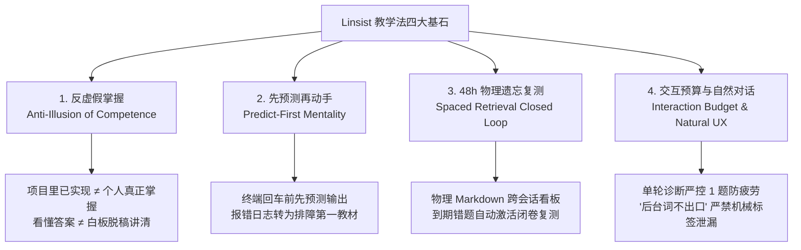

# Linsist：工业级计算机基础、Linux机制推演与 Java Agent / RAG 实战学习及模拟面试 Agent Skill 套件

<p align="center">
  <a href="https://github.com/Lin-sist/Linsist-Skill/actions/workflows/ci.yml"></a>
  <a href="LICENSE"></a>
  <a href="README.md"></a>
  
  
</p>

---

## 📖 项目简介

**Linsist** 是一套面向 Java 后端研发、操作系统底层机理与工业级受控 Agent / Enterprise RAG 体系的**个人技术学习陪伴与自适应模拟面试 Agent Skill 套件**。

对标现代 Agent Skills 规范（如 `teach`、`build-to-learn`），Linsist 致力于彻底解决技术学习中**“自以为看懂，实则无法脱稿讲清”、“脱离代码纸上谈兵”**以及**“跨会话学完即忘”**的三大核心痛点。

---

## 💡 四大核心教学哲学 (Core Philosophy)



1. **反虚假掌握 (Anti-Illusion of Competence)**：
   - 依赖大模型生成的现成代码或阅读已有开源项目，极易产生“全盘掌握”的认知幻觉。
   - 评判掌握度的唯一依据：能否脱稿向面试官讲清设计初衷 (Why)、能否在代码库中准确指出类与方法、能否指出典型失败场景 (Failure Modes)。
2. **先预测再动手 (Predict-First Mentality)**：
   - 在执行 Linux 观测命令、运行单元测试或提交代码前，学习者必须先做出定性预测。
   - 当测试变红时，绝不由 AI 越俎代庖直接修复，而是引导学习者按“现象 → 报错 → 定位 → 假设 → 验证 → 修复”自主攻坚。
3. **48h 物理间隔复测闭环 (Spaced Retrieval Closed Loop)**：
   - LLM 跨会话天然无状态。Linsist 采用本地 `.linsist/` 纯文本 Markdown 物理持久化，将核心认知盲点与手写题目转化为看板任务。开场自动扫描 48 小时到期题目，构建抗遗忘闭环。
4. **交互预算与“后台词不出口” (Interaction Budget & Natural UX)**：
   - 摸底测试单轮严格**仅限 1 题**，坚决杜绝连珠炮式提问带来的终端敲字疲劳。
   - 严禁在给用户的日常交流中泄露内部调度标签（如 `[学长复核：通过]`、`深讲固定四件套` 等），使用自然沉稳的高级工程师口吻研讨，结构化标记仅静默记录在本地笔记卡片中。

---

## 🏛️ 双层解耦架构 (Engine + Curriculum Packs)

Linsist 采用**“通用教练引擎 (Core Engine) + 领域精选路线包 (Curriculum Packs)”**的分层架构：

```text
Linsist-Skill/
├── skills/
│   ├── linsist-coach/
│   │   ├── SKILL.md
│   │   ├── scripts/                 # Bundled initializer and scanner
│   │   └── references/
│   │       └── curriculums/         # Bundled Java Agent/RAG and custom packs
│   ├── linsist-interviewer/
│   ├── linsist-agent/                # Resume-targeted offline Agent coding drills
│   ├── linsist-basics/
│   ├── linsist-os/
│   └── linsist-testlab/
├── scripts/
│   ├── install.py                  # Installs and checks the complete suite
│   ├── init_workspace.py           # Source-checkout compatibility entry
│   └── scan_retest.py              # Source-checkout compatibility entry
└── tests/                          # Unit and installed-workspace regression tests
```

---

## 🛠️ 技能与调用方式

| 技能 | 职责 | 自然语言示例 |
| :--- | :--- | :--- |
| `$linsist-coach` | 每日学习编排、费曼验收、间隔复测 | 用 Linsist 开始今天的学习 |
| `$linsist-interviewer` | 自适应模拟面试与统一复盘 | 用 Linsist 根据这份简历模拟技术一面 |
| `$linsist-agent` | 简历靶向 Agent 基础与离线手写 | 按我的简历开始一次 Agent 基础手写练习 |
| `$linsist-basics` | Java、集合、算法与手写训练 | 开始今天的 Java 基础训练 |
| `$linsist-os` | 操作系统机制与 Linux 实验 | 通过 Linux 实验学习进程调度 |
| `$linsist-testlab` | JUnit、Mockito 与断言分析 | 开始一次 JUnit 边界测试练习 |

已启用自然语言自动选择。如果同时装有相似教学技能，显式 `$技能名` 更可靠。Codex 可通过 `/skills` 或输入 `$` 查找技能。本套件没有注册 `/linsist`、`/study-coach` 等别名命令。

## 🚀 安装与首次使用

辅助脚本需要 Python 3.9+，默认运行不依赖第三方 Python 包。仓库测试需要 PyYAML；复杂 YAML 配置解析可选安装它。只有具体练习涉及 Java、Maven、Gradle 或 Linux 命令时，才需要对应环境。

### 1. 安装完整套件

```bash
git clone https://github.com/Lin-sist/Linsist-Skill.git
cd Linsist-Skill
python3 scripts/install.py
python3 scripts/install.py --check
```

默认安装到 `~/.agents/skills`，在该目录下直接生成 6 个 `linsist-*` 文件夹，并携带教练脚本与课程资源。如果源码仓库本身就在目标技能根目录内，安装器会创建目录符号链接，使 Codex 按规范化路径去重；其他情况下安装独立副本。没有符号链接权限的系统，请把源码放在技能根目录之外。链接安装会随本地源码修改同步生效。

Windows PowerShell 使用 `py -3 scripts/install.py` 和 `py -3 scripts/install.py --check`。其他客户端或项目可显式指定其支持的技能根目录：

```bash
# Claude Code
python3 scripts/install.py --dest ~/.claude/skills
# 项目级 Codex 技能；替换为你的实际项目路径
python3 scripts/install.py --dest /path/to/project/.agents/skills
```

Cursor、Windsurf、OpenCodeInterpreter 的扫描路径与调用语法以对应客户端版本为准，本仓库尚未完成这些客户端的实机验收。安装器默认保留已有目录；更新本套件使用 `python3 scripts/install.py --update`，该选项会替换已有 `linsist-*` 技能目录。个人笔记应保存在学习工作区，不放入安装目录。

### 2. 在学习项目或笔记目录中开始

下一轮对话选择 `$linsist-coach` 并输入：

```text
$linsist-coach 开始今天的学习，我的学习工作区是 /path/to/my-project。
```

教练会初始化缺失的工作区文件、检查到期复测，然后一次只提出一个问题。无需预先填完画像；也可以直接调用专项技能。模拟面试只需要本场简历与可选 JD，不会在启动时读取本地学习记录。

如果技能未出现，重启客户端后再检查。仓库测试能验证安装资源与脚本行为，模型是否正确自动选择技能、对话质量是否达标，仍需在对应宿主中实际验证。

### 3. 可选：手动初始化与复测

在任意目录执行时，使用已安装脚本的绝对路径，并用 `--dir` 指定学习根目录：

```bash
python3 ~/.agents/skills/linsist-coach/scripts/init_workspace.py --dir /path/to/my-project
python3 ~/.agents/skills/linsist-coach/scripts/scan_retest.py --dir /path/to/my-project --json
# 只读扫描
python3 ~/.agents/skills/linsist-coach/scripts/scan_retest.py --dir /path/to/my-project --json --no-dashboard
```

在源码仓库内，原有 `python3 scripts/init_workspace.py --dir ...` 与 `python3 scripts/scan_retest.py --dir ...` 入口仍然可用。

工作区包含 `.linsist/config.md`、`learner-profile.md`、`notes/`、`mistakes/` 与 `retest_dashboard.md`。原始笔记是复测状态来源，先改笔记再扫描。JSON 与普通输出默认均刷新完整看板；`--stage 1`、`--stage 2` 只筛选输出。扫描按机器本地日历日期判断到期，不是精确小时闹钟；安装不会创建后台定时任务。

### 4. 验证源码修改

```bash
python3 -m pip install -r requirements-dev.txt
python3 -m unittest discover tests -v
```

集成测试会在带空格的临时路径中安装全部技能，检查本地链接，从无关项目目录初始化，再执行“待复测 → 首轮通过 → 全部掌握”的状态流转，并检查重复初始化、只读扫描与已有安装保护。

---

## Agent Foundations：Linux 端简历靶向手写

`$linsist-agent` 沿用基础训练风格：一次概念摸底、最少讲解、一个 10～20 分钟手写函数、实际运行，再用一个问题验收面试表达。优先当前简历出现的 Agent 机制，允许一个小拓展，不把长期路线图变成必修清单。

- **P0**：有界 Loop、工具白名单、ReAct 动作/观测关联、状态迁移、上下文、分档记忆、提议确认、n-gram 护栏、单次反思与共享时间预算。
- **P1**：按面试缺口选学 RPC/MCP 基础、trace 元数据、离线评测；框架迁移、多智能体、GraphRAG、微调均不默认安排。
- 使用 Python 标准库和离线 Fake LLM，无需 API Key。脚手架刻意保留核心函数空实现；冒烟验证成功不等于手写题通过，每道题独立验收。

```text
$linsist-agent 按我当前简历开始一次 Agent 基础手写练习，提交代码前不要给完整实现。
```

`/linsist-agent`、`/agent-practice` 作为文本触发词；不会自动注册宿主 slash 命令。客户端拦截未知 slash 命令时请使用 `$linsist-agent`。本技能可独立开始练习，持久化复测复用完整套件已有 `.linsist/` 扫描器。私人简历不内置、不随套件公开。

详见 [课程范围](skills/linsist-agent/references/curriculums/agent-foundations/syllabus.md)、[手写题输入输出契约](skills/linsist-agent/references/curriculums/agent-foundations/exercises.md)、[项目口径差异与修复](skills/linsist-coach/references/curriculums/java-agent-rag/alignment-notes.md)。通用知识、独立实验与 Flashback/RAG 已实现能力必须分开，实验通过不自动变成简历项目经历。

---

## 📚 官方精选路线：Java 原生 Agent + Enterprise RAG

Linsist 内置官方首发精选路线包（位于 [`skills/linsist-coach/references/curriculums/java-agent-rag/`](skills/linsist-coach/references/curriculums/java-agent-rag/)）：

1. **Flashback 受控 Agent 核心体系 (S01 ~ S10)**：
   - 确定性状态机 (`AgentStageMachine`) 与防死循环跃迁
   - Native Function Calling 强类型 DTO 绑定与校验白名单
   - Human-in-the-Loop (HITL) 二段式确认与挂起事务
   - 共享全局超时预算 (`Shared Deadline Budget`) 与零隐式重试
   - 基于 MySQL 元数据检索、时间标签与分档字符预算的轻量记忆
2. **Enterprise RAG 检索工程核心体系 (S11 ~ S20)**：
   - 稠密语义 (Milvus IVF_FLAT；HNSW 仅作可选比较) + 稀疏关键词 (BM25) 双路召回
   - 倒数排名融合算法 (`RRF - Reciprocal Rank Fusion`) 数学机制
   - 启发式默认重排、可选模型重排与显式故障降级
   - 引用片段重合度校验 (`CitationValidator`)，不冒充语义蕴含验证
   - 索引任务账本与分布式租约看门狗 (`Lease Guard`)

*如需接入自定义业务工程，仅需参考 [`skills/linsist-coach/references/curriculums/custom-template/my-project.template.md`](skills/linsist-coach/references/curriculums/custom-template/my-project.template.md) 进行拓展。*

---

## 🤝 参与贡献 (Contributing)

欢迎提交 Issue 与 Pull Request！贡献方向包括：
- 补充更多领域的精选路线包（如：分布式高并发中间件、大模型微调推理工程）。
- 完善各类 IDE 与笔记软件（如 Obsidian、Logseq）的双链同步插件。
- 优化提示词交互预算与提问精度。

---

## 📄 开源许可证 (License)

本项目采用 [MIT License](LICENSE) 开源协议。
