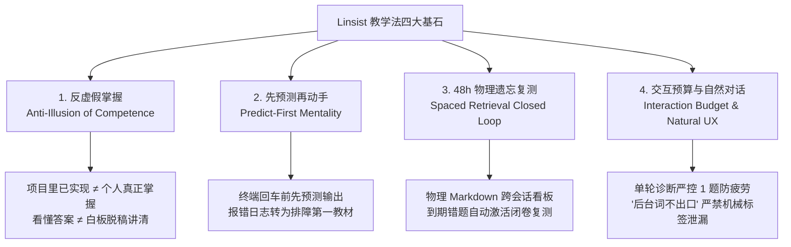

# Linsist：工业级计算机基础、Linux机制推演与 Java Agent / RAG 实战学习及模拟面试 Agent Skill 套件

<p align="center">
  <a href="https://github.com/Lin-sist/Linsist-Skill/actions/workflows/ci.yml"></a>
  <a href="LICENSE"></a>
  <a href="README.md"></a>
  
  
</p>

---

## 📖 项目简介

**Linsist** 是一套面向 Java 后端研发、操作系统底层机理与工业级受控 Agent / Enterprise RAG 体系的**个人技术学习陪伴与自适应模拟面试 Agent Skill 套件**。

对标现代 Agent Skills 规范（如 `teach`、`build-to-learn`），Linsist 致力于彻底解决技术学习中**“自以为看懂，实则无法脱稿讲清”、“脱离代码纸上谈兵”**以及**“跨会话学完即忘”**的三大核心痛点。

---

## 💡 四大核心教学哲学 (Core Philosophy)



1. **反虚假掌握 (Anti-Illusion of Competence)**：
   - 依赖大模型生成的现成代码或阅读已有开源项目，极易产生“全盘掌握”的认知幻觉。
   - 评判掌握度的唯一依据：能否脱稿向面试官讲清设计初衷 (Why)、能否在代码库中准确指出类与方法、能否指出典型失败场景 (Failure Modes)。
2. **先预测再动手 (Predict-First Mentality)**：
   - 在执行 Linux 观测命令、运行单元测试或提交代码前，学习者必须先做出定性预测。
   - 当测试变红时，绝不由 AI 越俎代庖直接修复，而是引导学习者按“现象 → 报错 → 定位 → 假设 → 验证 → 修复”自主攻坚。
3. **48h 物理间隔复测闭环 (Spaced Retrieval Closed Loop)**：
   - LLM 跨会话天然无状态。Linsist 采用本地 `.linsist/` 纯文本 Markdown 物理持久化，将核心认知盲点与手写题目转化为看板任务。开场自动扫描 48 小时到期题目，构建抗遗忘闭环。
4. **交互预算与“后台词不出口” (Interaction Budget & Natural UX)**：
   - 摸底测试单轮严格**仅限 1 题**，坚决杜绝连珠炮式提问带来的终端敲字疲劳。
   - 严禁在给用户的日常交流中泄露内部调度标签（如 `[学长复核：通过]`、`深讲固定四件套` 等），使用自然沉稳的高级工程师口吻研讨，结构化标记仅静默记录在本地笔记卡片中。

---

## 🏛️ 双层解耦架构 (Engine + Curriculum Packs)

Linsist 采用**“通用教练引擎 (Core Engine) + 领域精选路线包 (Curriculum Packs)”**的分层架构：

```text
linsist/                                 # 仓库根目录
├── README.md                            # 英文快速开始与规范
├── README.zh-CN.md                      # 中文完整指南与教学法
├── LICENSE                              # MIT 开源许可证
├── .gitignore                           # 忽略本地笔记与运行缓存
├── linsist.config.example.md            # 工作区配置模板
│
├── skills/                              # 【核心通用教练引擎】
│   ├── linsist-coach/                   # 学习陪伴教练中枢（每日切片规划、机制深挖、复测编排）
│   ├── linsist-interviewer/             # 自适应模拟面试官（技术一面自适应深挖、复盘报告交付）
│   ├── linsist-basics/                  # 计算机基础与手写代码（Java 基础、集合、算法、HTTP、SQL）
│   ├── linsist-os/                      # 操作系统与 Linux 机制（Ubuntu 命令实验、进程/内存/epoll/后端映射）
│   └── linsist-testlab/                 # 测试实战导师（JUnit 5、Mockito、AAA 规范、断言与质量门禁）
│
├── curriculums/                         # 【领域精选路线包】
│   ├── java-agent-rag/                  # 官方精选：Java 原生受控 Agent 与 Enterprise RAG 体系
│   │   ├── projects-context.md          # 工业级架构全景（Flashback & RAG 深度机制图谱）
│   │   └── syllabus.md                  # 拆解后的 20 个高频硬核知识切片
│   └── custom-template/                 # 社区开发者自定义项目路线模板
│       └── my-project.template.md
│
└── scripts/                             # 【辅助工具脚本】
    ├── init_workspace.py                # 一键初始化本地 .linsist/ 工作区
    └── scan_retest.py                   # 48h 待复测错题自动扫描与看板更新器
```

---

## 🛠️ 核心 Skill 矩阵与触发指令

| Skill 标识 | 中文全称 | 核心职责 | 触发口令 / Slash Commands |
| :--- | :--- | :--- | :--- |
| **`linsist-coach`** | 学习陪伴教练中枢 | 编排每日单点突破切片、控制互动节奏、组织 48h 看板复测、费曼机制验收 | `/study-coach`, `/linsist`, `开始学习`, `帮我复习`, `每日学习` |
| **`linsist-interviewer`**| 自适应模拟面试官 | 基于简历和目标 JD 全真自适应技术一面、深挖工程证据、输出结构化复盘 | `/mock-interview`, `/linsist-interview`, `技术模拟面试`, `模拟一面` |
| **`linsist-basics`** | 基础手写代码导师 | 聚焦 Java 基础、数据结构与高频手写题，分级阶梯提示，杜绝眼高手低 | `/basics-practice`, `/linsist-basics`, `开始今天的基础训练`, `手写代码训练` |
| **`linsist-os`** | 操作系统机制导师 | 结合 Linux 终端观测命令与 Java 后端映射，推演进程上下文、epoll 与内存分页 | `/os-lab`, `/linsist-os`, `开始今天的操作系统学习`, `OS机制推演`, `Linux实验` |
| **`linsist-testlab`** | 测试实战质量导师 | 将理论映射到真实测试类，指导 AAA 结构分析、故障驱动排障与质量防御 | `/testlab`, `/linsist-testlab`, `开始测试实践`, `测试用例演练`, `JUnit测试实战` |

---

## 🚀 快速开始 (Quick Start)

### 1. 初始化本地持久化工作区

在当前代码仓库或个人知识库根目录下运行初始化脚本：

```bash
# 自动生成 .linsist/ 目录、学习画像与 48h 看板
python scripts/init_workspace.py
```

执行后将自动生成：
- `.linsist/config.md`：工作区持久化参数。
- `.linsist/learner-profile.md`：根据自身求职方向配置个人画像。
- `.linsist/retest_dashboard.md`：48h 待复测物理看板。
- `.linsist/notes/`：存放每日学习卡片。

### 2. 将技能安装至各主流客户端环境

Linsist 严格遵循开放 Agent Skills 规范，可无缝安装至 Claude Code、OpenAI Codex / Operator、Cursor、Windsurf、OpenCodeInterpreter 以及各类通用 Agent 环境：

#### 📦 Claude Code (`~/.claude/skills/` 或工程根目录 `.claude/skills/`)
- **macOS / Linux**:
  ```bash
  mkdir -p ~/.claude/skills && cp -r skills/* ~/.claude/skills/
  ```
- **Windows (PowerShell)**:
  ```powershell
  New-Item -ItemType Directory -Force -Path "$HOME\.claude\skills"
  Copy-Item -Recurse -Force skills\* "$HOME\.claude\skills\"
  ```

#### 📦 OpenAI Codex / Agent Operator (`~/.codex/skills/` 或 `~/.agents/skills/`)
- **macOS / Linux**:
  ```bash
  mkdir -p ~/.codex/skills && cp -r skills/* ~/.codex/skills/
  ```
- **Windows (PowerShell)**:
  ```powershell
  New-Item -ItemType Directory -Force -Path "$HOME\.codex\skills"
  Copy-Item -Recurse -Force skills\* "$HOME\.codex\skills\"
  ```

#### 📦 Cursor (`.cursor/skills/` 或 `~/.cursor/skills/`)
- **macOS / Linux**:
  ```bash
  mkdir -p .cursor/skills && cp -r skills/* .cursor/skills/
  ```
- **Windows (PowerShell)**:
  ```powershell
  New-Item -ItemType Directory -Force -Path ".cursor\skills"
  Copy-Item -Recurse -Force skills\* ".cursor\skills\"
  ```

#### 📦 Windsurf (`~/.codeium/windsurf/skills/` 或 `.windsurf/skills/`)
- **macOS / Linux**:
  ```bash
  mkdir -p ~/.codeium/windsurf/skills && cp -r skills/* ~/.codeium/windsurf/skills/
  ```
- **Windows (PowerShell)**:
  ```powershell
  New-Item -ItemType Directory -Force -Path "$HOME\.codeium\windsurf\skills"
  Copy-Item -Recurse -Force skills\* "$HOME\.codeium\windsurf\skills\"
  ```

#### 📦 OpenCodeInterpreter / Antigravity / Gemini CLI / 标准 Agent 规范 (`~/.agents/skills/`)
- **macOS / Linux**:
  ```bash
  mkdir -p ~/.agents/skills && cp -r skills/* ~/.agents/skills/
  ```
- **Windows (PowerShell)**:
  ```powershell
  New-Item -ItemType Directory -Force -Path "$HOME\.agents\skills"
  Copy-Item -Recurse -Force skills\* "$HOME\.agents\skills\"
  ```

### 3. 会话中触发对应专精技能

- **每日学习陪伴**：输入 `/study-coach`、`/linsist` 或 `开始学习`，推进今日单点切片。
- **自适应技术一面**：输入 `/mock-interview` 并附上你的简历，开启 40 分钟高真度模拟面试与复盘。
- **代码手写与算法**：输入 `/basics-practice`，进行 15 分钟白板手写训练。
- **Linux 系统机理**：输入 `/os-lab`，进行命令行内核可观测性实验推演。
- **测试用例与质量门禁**：输入 `/testlab`，实战演练断言设计与故障复现。

### 4. 执行 48h / 168h 双轮遗忘复测扫描

随时运行扫描器，核查有哪些错题或手写任务已到达 48 小时初测或 168 小时（7天）巩固复测窗口：

```bash
# 标准交互式扫描并更新看板
python scripts/scan_retest.py

# 输出结构化 JSON（供脚本或 IDE 插件调用）
python scripts/scan_retest.py --json

# 仅筛选第 1 轮初测或第 2 轮巩固复测
python scripts/scan_retest.py --stage 1
```

扫描器将自动解析笔记卡片中的复测题目，标出逾期任务并静默更新 `.linsist/retest_dashboard.md`。

---

## 📚 官方精选路线：Java 原生 Agent + Enterprise RAG

Linsist 内置官方首发精选路线包（位于 [`curriculums/java-agent-rag/`](curriculums/java-agent-rag/)）：

1. **Flashback 受控 Agent 核心体系 (S01 ~ S10)**：
   - 确定性状态机 (`AgentStageMachine`) 与防死循环跃迁
   - Native Function Calling 强类型 DTO 绑定与校验白名单
   - Human-in-the-Loop (HITL) 二段式确认与挂起事务
   - 共享全局超时预算 (`Shared Deadline Budget`) 与零隐式重试
   - 基于 MySQL 时间指数衰减 (`Temporal Decay`) 的轻量记忆库
2. **Enterprise RAG 检索工程核心体系 (S11 ~ S20)**：
   - 稠密语义 (Milvus HNSW) + 稀疏关键词 (BM25) 双路召回
   - 倒数排名融合算法 (`RRF - Reciprocal Rank Fusion`) 数学机制
   - Cross-Encoder 深度重排序 (Reranker) 与启发式熔断降级
   - 句级别引用校验门禁 (`Citation Validator`) 拦截幻觉
   - 索引任务账本与分布式租约看门狗 (`Lease Guard`)

*如需接入自定义业务工程，仅需参考 [`curriculums/custom-template/my-project.template.md`](curriculums/custom-template/my-project.template.md) 进行拓展。*

---

## 🤝 参与贡献 (Contributing)

欢迎提交 Issue 与 Pull Request！贡献方向包括：
- 补充更多领域的精选路线包（如：分布式高并发中间件、大模型微调推理工程）。
- 完善各类 IDE 与笔记软件（如 Obsidian、Logseq）的双链同步插件。
- 优化提示词交互预算与提问精度。

---

## 📄 开源许可证 (License)

本项目采用 [MIT License](LICENSE) 开源协议。
