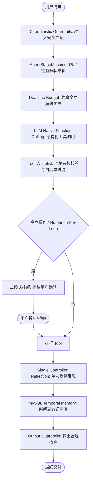
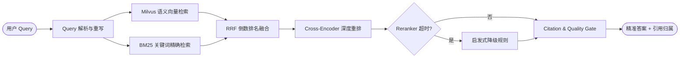

# Java 原生受控 Agent 与 Enterprise RAG 架构全景

> **课程包标识**：`curriculums/java-agent-rag`  
> **核心定位**：专为 Java 后端向 AI 工程转型、工业级受控 Agent 开发与高精度企业 RAG 打造的官方精选课程包。  
> **架构原则**：拒绝玩具级 Demo，聚焦确定性状态机、工具参数校验白名单、Human-in-the-Loop 安全确认、多路混合召回与引用校验门禁。

---

## 一、主项目 1：Flashback（Java 原生受控 Agent 架构）

Flashback 是一个面向工业级可靠性的 Java 原生 Agent Runtime，旨在解决传统开源 Agent 框架（如简易 ReAct、自主无限循环）中不可控、易死循环、难以监控与缺乏确定性约束的致命问题。

### 1. 核心工业级架构特性
1. **Java 原生受控 Agent Runtime**：完全基于 Java 强类型与 Spring Boot 生态构建，不依赖高风险的外部黑盒脚本。
2. **确定性状态机 (`AgentStageMachine`)**：将 Agent 运行生命周期严格约束在状态转移图中，彻底杜绝状态任意跃迁与无限自循环死锁。
3. **Native Function Calling 强类型对接**：模型生成标准的 `tool_calls` 结构化 JSON，Java 后端通过强类型 DTO 与参数校验器进行拦截校验。
4. **工具安全白名单与输入校验 (`Tool Whitelist & Schema Validation`)**：未注册工具绝对拒绝调度，参数类型、长度与正则边界在进入业务前 100% 验证。
5. **Human-in-the-Loop (HITL) 二段式确认机制**：
   - 对于涉及资金、删除、对外发送等破坏性写操作，Agent 将状态机挂起为 `WAITING_CONFIRMATION` 并返回确认凭单。
   - 必须等待用户明确确认或超时自动丢弃，绝不允许模型自主代为决定。
6. **轻量级持久化记忆与时间衰减 (`MySQL Temporal Memory & Decay`)**：
   - 采用关系型数据库保证会话事件的时序一致性与审计能力。
   - 引入时间衰减策略（Exponential Time Decay），越旧的对话权重越低，防范上下文窗口污染。
7. **确定性防护栏 (`Deterministic Guardrails`)**：双向过滤输入 Prompt 注入风险与输出敏感数据泄露，保障企业级合规。
8. **单次受控反思 (`Single Controlled Reflection`)**：严格限制自我反思最多 1 次，杜绝自言自语与 Token 爆炸。
9. **全局共享超时预算 (`Shared Deadline Budget`)**：跨多步 LLM 调用共享单一截止时间，底层 HTTP 客户端继承剩余预算，杜绝单次调用级联超时。
10. **零隐式自动重试原则 (`Zero Silent Retries`)**：针对非幂等外部工具调用，严禁在网络抖动时自动重放，所有失败显式捕获并回滚状态。
11. **端到端可观测性与评测 (`Trace & Agent Eval`)**：集成 OpenTelemetry 分布式链路追踪与基于真值基准集的自动化评测套件。

### 2. 明确的架构边界（知止而后有定）
- **无向量数据库 / 无 Embedding**：专注于受控任务编排与状态流转，不承担语义向量检索职责。
- **主链路无 SSE Streaming**：核心流程保证事务一致性与完整状态持久化，不进行未受控的流式输出。
- **无 LangChain / LangGraph 强耦合**：完全自研纯净状态机，避免引入庞杂的抽象层与维护债务。

---

## 二、主项目 2：Enterprise RAG（企业级多路召回与重排系统）

Enterprise RAG 专为企业级高精度知识库检索设计，解决传统单一向量检索中专有名词召回率低、跨语言匹配差、模型幻觉以及缺乏端到端质检的痛点。

### 1. 核心工业级架构特性
1. **多路混合召回架构 (Dense + Sparse Hybrid Search)**：
   - **稠密向量召回**：依托 Milvus 进行高维语义相似度检索，捕捉同义词与上下文关联。
   - **稀疏关键词召回**：基于 BM25 算法精准命中产品型号、技术专有名词、错误码等强精确词汇。
2. **倒数排名融合算法 (RRF - Reciprocal Rank Fusion)**：
   - 避开不同打分模型原始分值分布不齐的缺陷，通过排名倒数公式计算融合权重：
     $$RRF\_Score(d) = \sum_{m \in M} \frac{1}{k + r_m(d)}$$
3. **Cross-Encoder 深度重排序 (Reranker)**：
   - 引入 NVIDIA / BAAI Reranker 模型对 Top-K 候选切片与原始 Query 进行细粒度交叉注意力打分，大幅提升 Top-3 精确率。
4. **启发式故障降级保护 (`Heuristic Fallback`)**：
   - 当重排服务遭遇超时、网络抖动或显存溢出时，系统在 200ms 内优雅降级为基础 RRF 分数输出，确保可用性 SLA。
5. **引用校验门禁 (`Citation Validator & Claim Checker`)**：
   - 对大模型生成的回答进行逐句事实归属断言（Claim-to-Source Mapping），无依据生成的幻觉内容被直接拦截或标红。
6. **企业级租约看门狗 (`Lease Guard & Distributed Heartbeat`)**：
   - 构建高可靠索引任务账本，采用分布式租约与心跳看门狗防止长任务因节点宕机发生脑裂或悬挂。
7. **严格多租户数据隔离 (`Tenant Isolation`)**：
   - 无论在关系型元数据还是向量索引分区中，均实行强隔离策略，杜绝跨租户越权数据泄露。
8. **标准化自动化测试与评测基准**：
   - 建立包含 150 个真实问答对的 Golden Dataset，自动化度量 Recall@K（查全率）、Precision@K（查准率）、MRR 与生成忠实度。

### 2. 明确的架构边界
- **无自主 Agent Loop**：只专注于高效、高精度的检索、校验与上下文合成，不承担复杂多步规划。
- **无多轮会话状态堆积**：检索管道保持无状态，上下文由上层会话模块显式传入。

---

## 3. 面试表达与经历真实性原则 (Evidence-Based Pitch Constraint)

> **【自述表达铁律】**：
> 只有用户真实项目中已经实现，并能提供代码或测试证据的技术成果，才能作为个人项目经历陈述；未在用户工程中落地或缺乏证据支持的技术，只能作为『行业通用方案对比与选型思考』，严禁使用『我们实现了/建立了』的确定性第一人称经历表达。
> 
> - **已落地的项目经历**：可采用“业务痛点 → 机制选型 → 代码/测试凭证 → 量化收益”进行第一人称自述。
> - **未落地的调研与推演**：必须使用中立架构思考表达（例如：“在行业主流架构中……”、“在面临高并发检索时，我们选型对比过 HNSW 与 IVF……”），保证技术求职与项目交流的绝对诚信。
