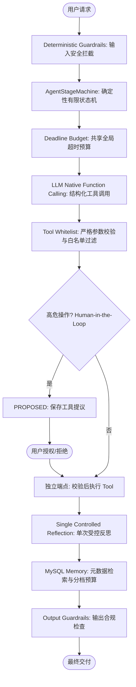
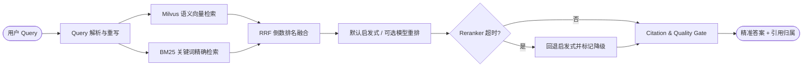

# Java 原生受控 Agent 与 Enterprise RAG 架构全景

> **课程包标识**：`java-agent-rag`
> **核心定位**：专为 Java 后端向 AI 工程转型、工业级受控 Agent 开发与高精度企业 RAG 打造的官方精选课程包。  
> **架构原则**：拒绝玩具级 Demo，聚焦确定性状态机、工具参数校验白名单、Human-in-the-Loop 安全确认、多路混合召回与引用校验门禁。

> **证据边界**：这是工程机制学习参考，不是可复用到任何简历的项目事实。先看 [项目口径差异](alignment-notes.md)；示例枚举、测试类与参数不自动视为真实实现。当前项目配置、代码版本与运行记录优先，离线原型不能包装成生产 SLA。

---

## 一、主项目 1：Flashback（Java 原生受控 Agent 架构）

Flashback 的简历主线是受产品约束的 Java Agent 对话引擎：通过代码控制阶段与追问边界，通过工具提议与独立确认端点分离生成和写入。通用 ReAct、框架编排与自研策略都需要显式的终止和失败约束，不按是否使用框架判断可靠性。

### 1. 核心工业级架构特性
1. **Java 原生受控 Agent Runtime**：完全基于 Java 强类型与 Spring Boot 生态构建，不依赖高风险的外部黑盒脚本。
2. **确定性状态机 (`AgentStageMachine`)**：用阶段策略与追问上限限制对话行为；同时需要步数、时间预算与失败处理，不能仅凭状态机保证无死循环。图中名称为教学简化，真实阶段以代码为准。
3. **Native Function Calling 强类型对接**：模型生成标准的 `tool_calls` 结构化 JSON，Java 后端通过强类型 DTO 与参数校验器进行拦截校验。
4. **工具安全白名单与输入校验 (`Tool Whitelist & Schema Validation`)**：未注册工具不调度；参数校验应与业务鉴权、所有者及状态检查配合，类型和格式正确不代表操作已获授权。
5. **Human-in-the-Loop (HITL) 二段式确认机制**：模型只提议工具参数，以 `PROPOSED` 保存；用户明确确认后由独立鉴权端点校验并写入。不是模型自主执行，也不据此推断存在通用挂起恢复运行时。
6. **轻量记忆与时间分档预算**：`MySqlMemoryPort` 查询标签与元数据，不取日记正文；`AgentTemporalPolicy` 注入时间标签并按时间档位裁剪字符预算。指数衰减可用于通用选型比较，不是当前项目实现描述。
7. **确定性护栏**：对回复与工具参数进行类型和规则校验，包括 n-gram 覆盖与未覆盖片段等检查；这些规则不能保证所有注入或语义捏造均被发现。
8. **单次受控反思**：只对策略允许的 typed violation 重写至多一次并关闭工具；当前代码支持时间归属缺失及特定问题数违规，排除 CLOSING、工具错误等非获准场景。
9. **全局共享超时预算 (`Shared Deadline Budget`)**：跨多步 LLM 调用共享单一截止时间，底层 HTTP 客户端继承剩余预算，杜绝单次调用级联超时。
10. **零隐式自动重试原则 (`Zero Silent Retries`)**：在所述业务编排中不做隐式自动重试；用户消息先持久化，失败后由显式手动重试与幂等约束处理，不笼统声称所有失败均回滚。
11. **端到端可观测性与评测 (`Trace & Agent Eval`)**：Flashback 有结构化轨迹与离线快照评测；OpenTelemetry 链路是所提供 RAG 简历的内容。可运行的离线测试不自动等于 CI 已配置。

### 2. 明确的架构边界（知止而后有定）
- **无向量数据库 / 无 Embedding**：专注于受控任务编排与状态流转，不承担语义向量检索职责。
- **主链路无 SSE Streaming**：核心流程保证事务一致性与完整状态持久化，不进行未受控的流式输出。
- **无 LangChain / LangGraph 强耦合**：完全自研纯净状态机，避免引入庞杂的抽象层与维护债务。

---

## 二、主项目 2：Enterprise RAG（企业级多路召回与重排系统）

Enterprise RAG 专为企业级高精度知识库检索设计，解决传统单一向量检索中专有名词召回率低、跨语言匹配差、模型幻觉以及缺乏端到端质检的痛点。

### 1. 核心工业级架构特性
1. **多路混合召回架构 (Dense + Sparse Hybrid Search)**：
   - **稠密向量召回**：依托 Milvus 进行高维语义相似度检索，捕捉同义词与上下文关联。
   - **稀疏关键词召回**：基于 BM25 算法精准命中产品型号、技术专有名词、错误码等强精确词汇。
2. **倒数排名融合算法 (RRF - Reciprocal Rank Fusion)**：
   - 避开不同打分模型原始分值分布不齐的缺陷，通过排名倒数公式计算融合权重：
     $$RRF\_Score(d) = \sum_{m \in M} \frac{1}{k + r_m(d)}$$
3. **可插拔重排**：默认 `HeuristicReranker`；模型重排用于可选对比，收益必须同时评估检索质量、延迟与外部依赖成本。
4. **故障降级**：可选模型重排不可用时回退启发式，并标记原因；不承诺未经实测的 200ms SLA。向量依赖失败的纯关键词回退属于另一个环节，不要混淆。
5. **引用片段校验**：`CitationValidator` 先匹配片段身份及原文，非 exact 时计算交集 token 数 / 引用片段 token 数，阈值 0.58；拒答不带引用。这不是 NLI 蕴含验证，也不是除以并集的 Jaccard，不能证明回答所有断言真实。
6. **企业级租约看门狗 (`Lease Guard & Distributed Heartbeat`)**：
   - 构建高可靠索引任务账本，采用分布式租约与心跳看门狗防止长任务因节点宕机发生脑裂或悬挂。
7. **严格多租户数据隔离 (`Tenant Isolation`)**：
   - 从可信登录凭证取得 tenant_id，并在关系型查询与 Milvus 标量过滤中下推；逻辑过滤不等于物理分区隔离，仍需覆盖所有读写路径的权限测试。
8. **标准化自动化测试与评测基准**：
   - 建立包含 150 个真实问答对的 Golden Dataset，自动化度量 Recall@K（查全率：检索出的前 K 个结果中包含的相关文档数 / 数据集中该 Query 真实相关文档总数）、Precision@K（查准率：检索出的前 K 个结果中相关文档数 / K）、MRR（首个真实相关文档排名的倒数均值）与生成忠实度。

### 2. 明确的架构边界
- **无自主 Agent Loop**：只专注于高效、高精度的检索、校验与上下文合成，不承担复杂多步规划。
- **无多轮会话状态堆积**：检索管道保持无状态，上下文由上层会话模块显式传入。

---

## 3. 面试表达与经历真实性原则 (Evidence-Based Pitch Constraint)

> **【自述表达铁律】**：
> 只有用户真实项目中已经实现，并能提供代码或测试证据的技术成果，才能作为个人项目经历陈述；未在用户工程中落地或缺乏证据支持的技术，只能作为『行业通用方案对比与选型思考』，严禁使用『我们实现了/建立了』的确定性第一人称经历表达。
> 
> - **已落地的项目经历**：可采用“业务痛点 → 机制选型 → 代码/测试凭证 → 量化收益”进行第一人称自述。
> - **未落地的调研与推演**：必须使用中立架构思考表达（例如：“在行业主流架构中……”、“在面临高并发检索时，我们选型对比过 HNSW 与 IVF……”），保证技术求职与项目交流的绝对诚信。
