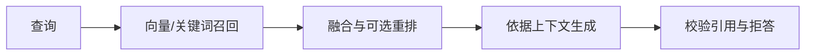

# 可选 Java Agent / RAG 教学场景

本课程包只提供机制示例，不代表作者或学习者的真实项目。默认不激活；只有用户的简历与目标涉及这些内容时，才挑选一个对应切片。项目名称、配置、语言和实现方式都应由用户材料决定。

先按 [简历对齐检查表](alignment-notes.md) 区分通用方案、独立练习与已核验项目证据。示例类名、状态名和阈值仅用于说明，不宣称某个仓库已有实现。

## 场景 A：受控工具助手

- Loop 需要步数、时间与失败边界；有限状态机本身不能保证所有循环均可终止。
- Tool Calling 需要白名单、入参校验和业务鉴权；HITL 可采用提议确认或运行时暂停恢复，不能混称为同一种项目实现。
- Context 和 Memory 应区分召回、筛选、时间标签与预算；分档、指数衰减和摘要是不同策略。
- Reflection 只在明确条件和预算内发生。是否重试、是否关闭工具、如何降级以真实契约为准。
- Trace 只记录获准的元数据；离线行为测试与真实模型质量需要分别验证。

## 场景 B：检索增强问答

- 混合检索、RRF、索引类型和重排只是候选方案，不预设默认参数或效果。
- 向量依赖失败、模型重排失败和生成失败是不同的降级层，返回时应保留真实结果状态。
- 片段能回连原文不等于回答被语义蕴含；重合度公式必须看实际分母，不能凭名称猜测。
- 租户过滤需要可信身份与全读写路径约束；逻辑标量过滤不等于物理隔离。
- 对外暴露 MCP 工具的服务不一定包含 Agent Loop；不能把工具服务能力当成自主编排能力。

## 经历真实性

只有用户真实项目中已经实现，并能提供代码或测试证据的技术成果，才能作为个人项目经历陈述；未在用户工程中落地或缺乏证据支持的技术，只能作为行业通用方案比较，严禁使用『我们实现了/建立了』的确定性第一人称经历表达。

面试复述只基于用户的证据。独立实验可表述为“在本次实验中验证了……”，不能直接改写为用户项目成果。
